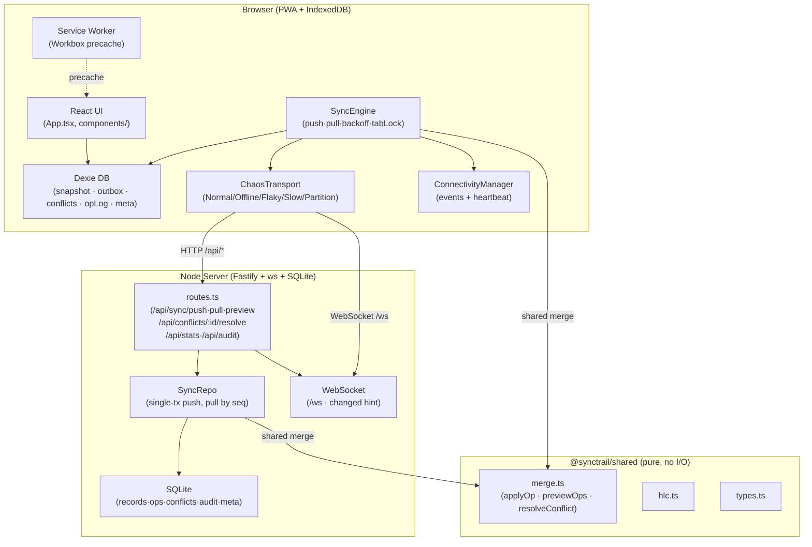

# SyncTrail

Offline-first field-survey app with a **no-silent-data-loss guarantee**. Built for ALGOTHON'26, problem **ALG-WEB-02 (Offline-First Application)**.

> Edits made offline always survive. Non-overlapping edits merge automatically. Real conflicts are shown to a human with full context. Nothing is ever silently overwritten.

**Live demo:** not deployed yet (no public URL exists; see [`docs/DEPLOY.md`](docs/DEPLOY.md)) · **Demo video:** not recorded yet

---

## Architecture



### Key decisions

| Decision | Rationale |
|---|---|
| Immutable ops with `opId` | Server dedupes; client retries are safe at any frequency |
| `cur.hlc === baseHlc` for conflict detection | No wall-clock dependency; avoids both last-write-wins and false-conflict |
| One pure `merge.ts` shared by client and server | Cannot diverge; mutation-checked by test suite |
| HLC for ordering | Monotonically increases even with backward-running clocks |
| Conflicts are data, not errors | Stored in SQLite and Dexie; never block other sync work |
| Heartbeat + browser events for connectivity | Detects captive portals and NAT drop; never trusts `navigator.onLine` alone |
| Web Locks API for single-tab sync loop | Zero extra state; browsers handle tab teardown automatically |

---

## Quick start

```bash
npm install
npm run dev          # server :3001, web :3000
npm run verify       # typecheck → lint → edge-table check → unit tests → sim → build
npm run test:sim     # randomized convergence simulation (200 seeds, 2000 fast-check)
npm run test:e2e     # Playwright, two browser contexts, 15 tests
```

> **From a clean clone:** `npm install && npm run verify && npm run test:e2e` — all must be green.

### Production build

```bash
npm run start:prod   # build, then one process serves the API, /ws and the PWA on :3001 (SERVE_STATIC=1)
docker build -t synctrail . && docker run -p 8080:8080 -v synctrail-data:/data synctrail
BASE_URL=https://<host> npm run test:smoke   # short Playwright check against a running deployment
```

HTTPS/wss, storage, environment variables and the reset endpoint: [`docs/DEPLOY.md`](docs/DEPLOY.md).

---

## Demo script (2 minutes)

1. Open two browser profiles as **Meera** (use user switcher) and **Dev**. Both show "Synced".
2. Use **Chaos Mode → Offline** on both, or DevTools → Network → Offline.
3. Meera edits Household #42: notes and status. Outbox: "2 waiting".
4. Dev edits #42 phone and status; deletes #57.
5. Reconnect Meera: Sync preview → "2 merge cleanly". Sync. Badges turn Synced.
6. Reconnect Dev: preview → "phone merges cleanly; status conflicts; #57 delete conflicts".
7. Dev resolves in the **Conflict inbox** (ancestor, mine, theirs, authors, times). Meera's screen updates live.
8. Open **Dashboard** → audit trail shows the full lifecycle.
9. Chaos page → **Run convergence check**: `runSimulation` (packages/shared/src/sim.ts) runs 200 seeded sessions against the real merge and shows a 7-invariant checklist with counts and the measured time. **Compare with last-write-wins** runs the same seeds through a naive LWW comparison harness and shows lost edits (SyncTrail: 0).

---

## Testing

Full details: [`docs/05_TESTING_PLAN.md`](docs/05_TESTING_PLAN.md). Edge-case table: [`docs/evidence/edge-cases.md`](docs/evidence/edge-cases.md).

| Layer | Tool | Coverage |
|---|---|---|
| Shared: merge, HLC, edge cases, sims | Vitest + fast-check | 29 tests: 14 merge/HLC, 6 edge cases, 200-session sim (6 invariants), `runSimulation` (7 invariants), 2 × 1000 fast-check runs with hostile clocks |
| Server integration | Vitest + Fastify inject | 32 tests: push, pull, preview, conflicts, restart, per-op validation, epochs, body limits, static serving |
| Client | Vitest + fake-indexeddb | 38 tests: outbox, sync engine, dead-letter, pull safety, tab lock, Dexie upgrade, restart during sync against a real server process |
| E2E | Playwright (2 contexts) | 15 tests incl. Scenario 6 (interrupted 120-op backlog) and Scenario 7 (Chaos Flaky) |
| Deployment smoke | Playwright against `BASE_URL` | health, JSON 404, app shell, `/ws`, Synced, records |

Evidence: [`docs/evidence/`](docs/evidence/)

---

## Known limitations

- **No real authentication.** User identity is a client-side switcher (Meera / Dev / Arjun). Any browser tab can impersonate any user.
- **One entity type.** Only Household records. Adding a second entity type would require extending the shared schema.
- **Free-text notes conflict as a whole field, not per character.** Character-level merge (Yjs/CRDTs) is listed as a future improvement.
- **Single-node server.** The Fastify/SQLite server is a single process with no replication. A restart during sync is handled gracefully but there is no HA.
- **30% packet loss is simulated client-side only.** The Flaky profile drops requests before they leave the browser; the server never sees the dropped packets.
- **IndexedDB quota.** Large photo attachments are out of scope; text-only records are small.

---

## Future improvements

- Character-level merge for `notes` (Yjs or Automerge)
- File/photo attachments with blob storage
- Multi-node server with PostgreSQL and CRDT-aware conflict resolution at scale
- Push notifications for incoming conflicts (Web Push API)
- Per-field permissions and role-based merge policies

---

## AI disclosure

This project was built with AI-assisted coding (Google Antigravity agent) under explicit phase-gated verification rules:

- Every phase required all tests to pass before the next phase could begin.
- The shared merge engine (`packages/shared/src/merge.ts`) was provided as a starter file and kept **unchanged** throughout (SHA256-verified at each phase). Only test extensions were added.
- Application code (server, client, sync engine, UI) was generated by the AI agent and verified by human-readable gate criteria (test output, Playwright videos, screenshots).
- The convergence simulation and fast-check property tests were specified by the human and generated by the agent; their correctness was verified by mutation testing (forcing "always apply sets" makes the suite fail).
- Remediation phases fix-R1 to fix-R4 (after an independent review) were implemented by Devin (Cognition AI), with the same gates.
- All test evidence is committed to `docs/evidence/`.
